# Hey, I'm Kunal Waghmare 👋

### Cloud DevOps Engineer | Site Reliability Engineering | Platform Engineering | DevSecOps

  
  <strong>Building reliable, scalable, secure and automated cloud infrastructure.</strong>

  
  
  

---

## 👨‍💻 About Me

I'm a Cloud DevOps Engineer and Site Reliability Engineering enthusiast with **3+ years of professional engineering experience**, specializing in cloud infrastructure, Kubernetes orchestration, infrastructure automation, CI/CD engineering and production reliability.

I enjoy engineering systems that are scalable, observable, secure and resilient.

- ☁️ Cloud Infrastructure: AWS & Google Cloud Platform
- ☸️ Containerization & Orchestration: Docker, Kubernetes & Helm
- 🏗️ Infrastructure as Code: Terraform & Ansible
- 🔄 CI/CD & GitOps: Jenkins, GitHub Actions, GitLab CI & ArgoCD
- 📊 Observability: Prometheus, Grafana, ELK, Loki & Tempo
- 🔐 DevSecOps: Trivy, IAM, RBAC & Secrets Management
- 🐍 Automation & Scripting: Python & Bash
- 🎯 Engineering Focus: Reliability, automation, security and platform engineering

**Professional Highlights**
- 3+ years of professional engineering experience.
- Supported infrastructure and deployments for 10+ microservices.
- Worked toward maintaining 99.9% service availability.
- Focused on reducing deployment time, infrastructure provisioning effort and operational overhead.

---

## 🚀 Featured Projects

A collection of engineering projects focused on cloud infrastructure, reliability, automation, security and systems engineering.

### 🛡️ Ubuntu Vulnerability Engine (UVE)
A Python-based CLI security auditing tool designed to identify and assess vulnerabilities in Ubuntu environments.

- Automated security auditing.
- Vulnerability assessment and reporting.
- Published on PyPI.

### ☸️ Valkyrie Platform
A cloud-native DevOps platform built around Kubernetes and GitOps principles.

- AWS EKS
- Terraform
- ArgoCD
- Prometheus
- Infrastructure automation and observability.

### ⚙️ OpsForge 2.0
An engineering initiative focused on DevOps automation and operational tooling.

### 📈 Reliability Control Plane
An engineering project exploring centralized reliability management, operational visibility and infrastructure control.

### 🗄️ QuillDB
A database engine project developed using Rust, exploring database internals and systems engineering.

### 🔬 SparkSight
An engineering project focused on data and operational insights.

### 🏥 Healthcare RCM Data Platform
A cloud-oriented data platform project focused on healthcare revenue cycle management workflows.

### 🔗 TradeBridge
A microservices-based application built around .NET architecture.

---

## 🛠️ Technology Stack

### Programming & Scripting

  

### Cloud Platforms

  

### Containers & Orchestration

  

### Infrastructure as Code & Automation

  

### CI/CD & GitOps

  

### Monitoring & Observability

  

**Additional Tools:** Loki, Tempo, Trivy, AWS CloudWatch, Google Cloud Operations Suite.

### Databases & Version Control

  

### Development Tools

  

---

## 📊 GitHub Statistics

  
  

## 🏆 GitHub Achievements

  
  
  

## 🎯 Currently Interested In

- Cloud-native architecture and Kubernetes engineering.
- Advanced Site Reliability Engineering practices.
- Infrastructure automation and GitOps.
- DevSecOps and automated vulnerability management.
- Observability and distributed systems.
- Building production-grade developer platforms.

---

## 🤝 Let's Connect

I'm always interested in discussing cloud infrastructure, DevOps engineering, Kubernetes, SRE, automation and interesting engineering projects.

  
  

  <i>"Automate everything that can be automated. Monitor everything that matters. Build systems that can recover."</i>

  ⭐ If you find my projects interesting, consider giving them a star!

---

  Designed and maintained by Kunal Waghmare · Cloud DevOps Engineer

